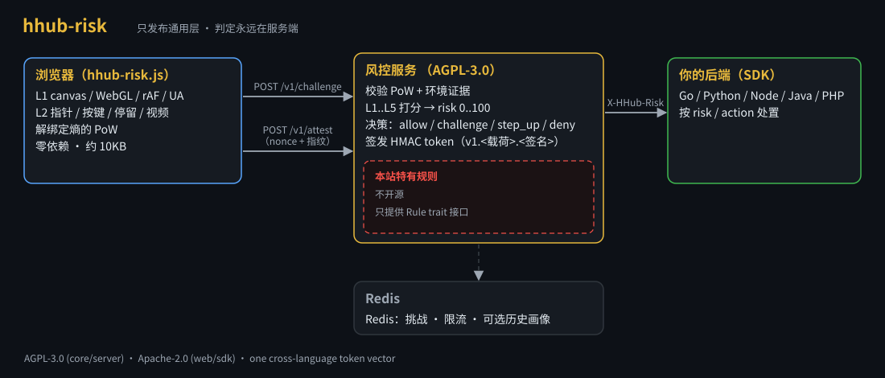

**[English](README.md)** · **中文**

# hhub-risk

> Self-hosted risk layer for social platforms: browser attestation + behaviour scoring +
> IP/geo consistency, with a pluggable captcha.
>
> **许可证是分开的**：后端（`core/`、未来的 `server/`）**AGPL-3.0**；
> 前端与 SDK（`web/`、`sdk/*`）**Apache-2.0**。详见 [LICENSE 说明](#许可证)。

[](docs/arch.zh.svg)

## 为什么

自托管社交平台（Mastodon、Misskey、小型社区）经常只有两个选择：挂一个闭源验证码（用户数据出境），
或者什么都不做（被注册机淹没）。这个项目想做第三件事：

- 数据不出自己的服务器；
- 判定在**服务端**，客户端只采集（白箱也能有效）；
- 验证码**可插拔**（自带 ALTCHA / Cap / Turnstile 也行）；
- 接入成本按"几行代码"算，而不是"读三天文档"。

## 现状

| 层 | 内容 | 状态 |
|---|---|---|
| L1 浏览器见证 | canvas/WebGL/rAF/UA 一致性 + 绑定熵的 PoW | 已在 HHub 生产使用 |
| L2 行为评分 | 指针/触摸/按键/停留/改选/看视频 → 0~100 分 | 已在 HHub 生产使用 |
| L3 网络地理 | IP → 国家/省/市；时区/语言一致性 | ✅ 已在 HHub 生产使用 |
| L4 长期画像 | 指纹/IP 日表、长期矛盾规则 | ✅ 已在 HHub 生产使用（规则本身不开源） |
| L5 账号/会话 | 新设备/无痕/主设备 | ✅ 无痕闸门（方案 B：邮箱 step-up）已在 HHub 生产使用 |
| 协议 | `/v1/challenge` `/v1/attest` `/v1/score` `/v1/verify` | ✅ 参考 server + OpenAPI（支持 Redis 共享挑战 + 按 IP 限流） |
| 前端 | 零依赖 `hhub-risk.js` + React/Vue/WebComponent | ✅ 真浏览器端到端冒烟通过 |

## 三分钟跑通（Docker）

```bash
docker compose up --build
# 示例页 http://localhost:8092 —— 点一下按钮就能看到 token / risk / reasons
```

## 仓库结构

```
risk/
  core/            Rust crate：信号打分、决策、token 签名（无 IO，可嵌进任何 Rust 服务）
  server/          参考 HTTP 服务（std + serde_json，无 web 框架）+ OpenAPI
  web/             前端 SDK（零依赖）+ React / Vue / Web Component 薄壳
  sdk/{go,python,node,java,php}/   本地验签 + 中间件
  deploy/          nginx / 部署说明
  LICENSE-AGPL-3.0 / LICENSE-APACHE-2.0
```

已有：`sdk/{go,python,node,java,php}`（全部 Apache-2.0，同一套跨语言测试向量）。
后续：`server/`（参考 HTTP 服务）、`web/`（零依赖原生 JS + React/Vue/Svelte 薄壳）。

## 许可证

| 部分 | 许可证 | 为什么 |
|---|---|---|
| `core/`（Rust 库）、未来的 `server/` | **AGPL-3.0** | 服务端是整个风控的判定核心；AGPL 保证"改了就要回馈"，同时允许商业闭源部署（只要不改服务端） |
| `web/`（原生 JS / 框架薄壳）、`sdk/*`（Go/Python/Node/Java/PHP） | **Apache-2.0** | SDK 是**独立进程的 HTTP 客户端**，不链接 AGPL 代码，不能被"传染"；Apache 2.0 带专利授权，企业最放心 |

**兼容性**：Apache-2.0 与 GPLv3/AGPLv3 兼容（FSF 认可），所以 Apache 的 SDK 可以被 AGPL 的服务端一并分发；
反过来不成立——**不能**把 AGPL 代码放进 Apache 组件里再以 Apache 发布。
实际边界：SDK 只通过 `HTTP + HMAC token` 与服务端通信，属于"独立作品"，不构成衍生。

每个源文件头部都有 SPDX 标识：
`// SPDX-License-Identifier: AGPL-3.0-only`（后端）或 `// SPDX-License-Identifier: Apache-2.0`（SDK/前端）。

## 边界

- **开源的是通用层**：验证码、PoW、浏览器见证、IP 地理、评分框架；
- **不开源的是本站特有的风控规则**（社交媒体场景的养号/刷屏/假互动等）。仓库里只会有
  **接口**与**场景启发清单**，不会包含任何站点的具体阈值与特征。
